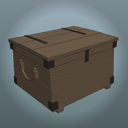

**Download: [the latest release](https://github.com/Dixiecapt/BaseCamp/releases/latest)** - `BaseCamp-0.1.3.zip` to install by hand, `BaseCamp-0.1.3-thunderstore.zip` for a mod manager, and the illustrated guide `Base Camp - Guide.pdf`.

# Base Camp - A Portable Wall Tent

**A canvas wall tent for Sailwind, with a cot to sleep in and a little wood stove to cook on. Buy it at Fort Aestrin packed in a worn old sea chest, carry it aboard, sail anywhere and pitch it on any island's land. Whatever you leave inside is kept, as in a house.**

*Version 0.1.3 (beta). Please report any bugs to Dixiecapt with your BepInEx log (`BepInEx\LogOutput.log`).*

The illustrated guide, **Base Camp - Guide.pdf**, comes with the download.

| | |
|---|---|
| Price | 1000 Aestrin Crowns (at Fort Aestrin) |
| Tent | 4.3 x 5.0 m, ridge 2.75 m, walls 1.25 m |
| Sleeps | 1 - the cot is a bed |
| Stove | 3 logs, about 3 game hours each |
| Packed | a sea chest, 1.08 x 0.84 x 0.67 m, 20 kg |
| Save numbers | house 1255, chest item 32755 |

## Buying it
- The tent is sold at **Fort Aestrin**, packed in its chest, by the **map and instrument seller's stall**: the chest stands on his floor between his crates and the tall crate stack.
- It is sold like any item in the game. Look at it and the game's yellow words show **pick up** and **buy Base Camp - Wall Tent for 1000 Aestrin Crowns**, with the key icons. Press the **use** key to buy it; the chest goes straight into your hands.
- **Buying the chest is buying the tent.** It is yours from the moment you pay.
- The price shown can move a little, as every item's does, with the Crown's rate and your reputation's discount at the Fort.
- The chest is too big for a pocket: carry it in your hands, or set it aboard your ship.
- One tent per game. Once bought, it is never offered again in that save.
- With **Lilith's Furniture** installed, its barrel cradle that stood on that spot is moved about 1 m toward the street.

## Pitching it
1. Pick up the chest and carry it onto land. While you just carry it, no outline shows; the words beside the chest say "Press the use key to choose a place for your tent".
2. Press the game's **use** key (the one that eats, drinks or reads) while you hold the chest. This starts choosing a place; it does not pitch the tent yet.
3. Now a see-through outline of the tent follows where you look, within 8 m, with its door facing you. Walk and look around until you find a good spot:
   - **pale green**: it fits, and the words beside the chest say "Press the use key to pitch your tent here";
   - **pale red**: it doesn't, and the words say why.
4. On green, press the **use** key again. The tent goes up there and the chest is used up. On red, the use key only tells you why, and you keep choosing.

To stop choosing, set the chest down (or board a boat, or go into the water); the outline goes away. Pick it up and press use to choose again.

Setting the chest down never pitches it: put it down anywhere and it stays a chest. Only the chest in your hands, with the use key, pitches the tent. The press that buys the chest at the Fort never starts choosing a place.

It can be pitched on the land of any of the game's islands. Once up, it stays with its island.

Why it won't fit:

| The game says | Meaning |
|---|---|
| Too steep here. | Some ground under it is tilted too much, or it is more than 45 cm out of level across the tent. |
| Too close to the water. | Its ground is under 0.5 m over the sea, or the sea is within 1.5 m of it. |
| Something is in the way here (...). | A building, dock, wall, fence, tree or other solid thing stands where it would go. |
| That is someone's house - pitch it in the open. | It would be inside a house. |
| That is not an island's land. | You are looking at something that isn't an island's ground. |
| Not enough land here for the tent. | The land runs out under it. |
| Too far - come closer. | The spot is more than 8 m away. |
| Not aboard a boat - pitch it on land. | You are on a boat. Carry it ashore first. |
| Not in the water. | You are swimming. |
| Not indoors - take it outside. | You are inside a building. |
| Your tent is pitched already. | Your tent is already up somewhere. |

## Living in it
- **The cot** is a bed. Click it and you lie down as in your own bed; any click gets you up.
- **The door flaps** roll up and down with a click.
- **Head room:** the roof is low at the sides. Standing, you stop where your head would meet the canvas; crouch to get right to the walls (you stay crouched until you move back toward the middle).
- **Lantern hooks:** the game's lamp hook fixes to the ridge pole and the two upright poles, so you can hang a lantern (and, with **HooksHangMore**, whatever that mod lets you hang). A hook in the tent is kept with it like any thing.
- **Your things are kept.** Set things down inside and they are saved with your game, as in a house, and come back where you left them.

## The stove
A little stove on a hearth stone at the back, part of the tent. With **Better Stoves** installed it is its Tiny Stove; without it, it looks like the game's own Aestrin stove. It works the same either way.
- **Lighting it:** hold a firewood log you have bought and click it on the stove. It lights straight away. It holds 3 logs and burns one at a time, about 3 game hours each, so a full stove lasts about 9 hours.
- It refuses wood you haven't paid for ("Buy the firewood first."), wood that is cargo for a delivery, and more than it holds ("The stove is full.").
- While it burns: flames, firelight and door glow with a slow flicker, glowing coals, the logs in the firebox, the crackle, and smoke from the pipe. When the last log burns out it goes dark and quiet.
- **Cooking:** hold a pot, pan or food and click it on the stove, its top or its front, or set it down on the top. It cooks the game's own way, sizzling as it goes. One thing at a time. Vittles and other mods see it as a lit stove.
- Looking at it tells you "2 / 3 logs - burning" or "no wood - cold".
- Its logs and how far the fire has burned are saved with your game.

## Packing up
1. Take your things out of the tent. You can keep what you are carrying.
2. Let the stove burn out.
3. Click the **rolled canvas** lying on the floor under the cot (its end shows past the cot's foot).
4. The tent comes down, cot and stove too, and its chest (**Base Camp - Wall Tent**) is set down in front of you.

If it can't pack yet, it says why: "Buy the tent first.", "Take your things out first. (3 still in the tent)" or "Let the stove's fire burn out first."

**Crates:** the things in a crate go with their crate.
- A crate in the tent counts as **one thing** in "still in the tent", however much is in it.
- Carry a crate out of the tent and what is in it goes out with it. It no longer counts as left in the tent.

## Saving and loading
- Where the tent stands, which island, which way its door faces, or that it is packed, is saved with your game.
- When you load, the tent is put back up before your things are read, so they return inside it, where you left them.

## Good to know
- There is one tent per game, so look after its chest: a chest lost at sea or destroyed is not replaced.
- A crate's contents stay with the crate. Take a crate of firewood out of the tent and its logs go with it.
- On uneven ground the canvas can sit a little above the lowest point, up to about 18 cm.
- A save that holds the chest needs this mod, or Save Cleaner, to load, like any modded item. Remove the mod only with the chest out of your save, or with Save Cleaner installed.

## Settings (F1, "Base Camp - A Portable Wall Tent")
- **For sale at Fort Aestrin** (on). A tent you have already bought is always kept.
- **Tent price in Aestrin Crowns** (1000).
- **Tent save number** (1255). Change it only if another mod uses 1255.
- **Sale spot nudge east** and **Sale spot nudge north** (0 m): move the chest for sale if it stands in something's way.

## Numbers it uses
| What | Number |
|---|---|
| House | 1255 (F1) |
| Chest item | 32755 |
| Save notes | `BaseCamp.Place`, `BaseCamp.Stove` |

## Works with Tamarack Island & Dalkey Reef
That mod has a wall tent of its own, sold at its lumber camp (house 1254, chest 32753). Base Camp is the same tent on its own, for players who want the tent without the new islands. If you have both, you have two tents: they keep their own numbers, chests and notes and never mix.

## Requirements
- BepInEx 5.
- **Better Stoves** is optional: with it, the stove is its Tiny Stove.

## Installing
With a mod manager, install it as usual. By hand: put `BaseCamp.dll` in `BepInEx\plugins\BaseCamp\`.

## Credits
- **Dixiecapt** - the mod.
- Made by Dixiecapt with the help of Claude (AI).
- **Tiny Stove model** by **olegiliushov** (open use licence), from **Better Stoves** (Dixiecapt with M.I.D.N). It shows when Better Stoves is installed and is not shipped with this mod.
- Inspired by the wall tent of **Tamarack Island & Dalkey Reef**.

## Licence
MIT.
